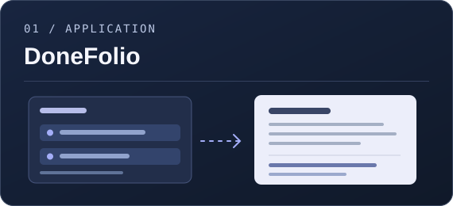
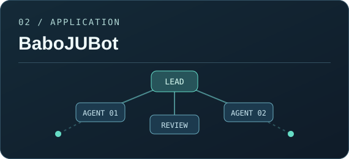
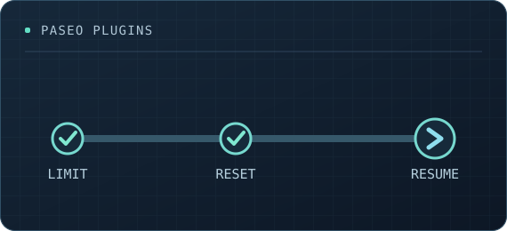
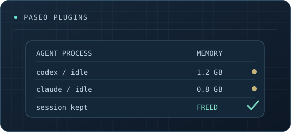
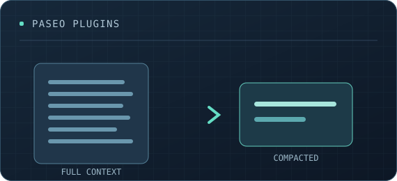
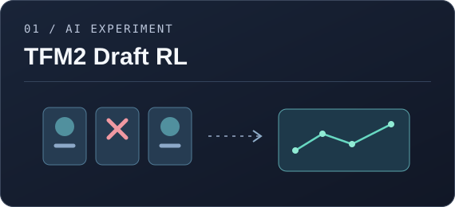

  

  <a href="#ai-applications">AI Applications</a> &nbsp;·&nbsp;
  <a href="#paseo-plugins">Paseo Plugins</a> &nbsp;·&nbsp;
  <a href="#ai-experiments">AI Experiments</a>

 

## AI Applications

<table>
  <tr>
    <td width="50%" valign="top">
      
      <h3><a href="https://github.com/babo-jeonguk/DoneFolio">DoneFolio ↗</a></h3>
      
An evidence-first career workspace for organizing work records and turning them into tailored resumes, with optional AI-assisted writing.

      Private repository · In development
    </td>
    <td width="50%" valign="top">
      
      <h3><a href="https://github.com/babo-jeonguk/BaboJUBot">BaboJUBot ↗</a></h3>
      
A human-supervised research workspace for planning, coordinating, and reviewing work across teams of AI agents.

      Early-stage prototype
    </td>
  </tr>
</table>

## Paseo Plugins

Small tools that improve day-to-day workflows in <a href="https://paseo.sh">Paseo</a>.

<table>
  <tr>
    <td width="33%" valign="top">
      
      <h3><a href="https://github.com/babo-jeonguk/paseo-usage-auto-resume">Usage Auto Resume ↗</a></h3>
      
Automatically continue eligible agent sessions after usage limits reset.

      Session continuity
    </td>
    <td width="33%" valign="top">
      
      <h3><a href="https://github.com/babo-jeonguk/paseo-free-your-agents">Free Your Agents ↗</a></h3>
      
Inspect memory use and stop idle agent processes without losing conversations.

      Process management
    </td>
    <td width="34%" valign="top">
      
      <h3><a href="https://github.com/babo-jeonguk/paseo-auto-compact-for-claude">Auto Compact for Claude ↗</a></h3>
      
Compact large, idle Claude conversations before their prompt cache expires.

      Context management
    </td>
  </tr>
</table>

## AI Experiments

<table>
  <tr>
    <td width="50%" valign="top">
      
    </td>
    <td width="50%" valign="top">
      <h3><a href="https://github.com/babo-jeonguk/tfm2-draft-rl">TFM2 Draft RL ↗</a></h3>
      
Exploring a reproducible reinforcement-learning agent for ban/pick decisions in Teamfight Manager 2.

      Early research · Rules and assets audit
    </td>
  </tr>
</table>

---

<a href="https://github.com/babo-jeonguk?tab=repositories">Explore all repositories ↗</a>
